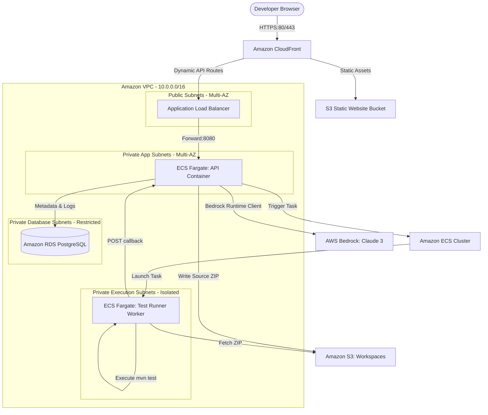

# AWS Cloud Architecture Blueprint

This document specifies the target AWS production architecture for the **Cloud-Based AI Software Testing Platform**.

---

## 1. Cloud Architecture Schematic

The platform is deployed inside a multi-AZ VPC configured for subnet isolation, with public load balancing and private secure computation.



---

## 2. Component Design Specifications

### A. Static Web Hosting
* **Amazon CloudFront**: Acts as the global content delivery network (CDN) securing endpoints with AWS ACM SSL Certificates. Enforces HTTP-to-HTTPS redirects.
* **Amazon S3 (Web Bucket)**: Stores the optimized React/Vite frontend static production assets (HTML, CSS, JS).

### B. Core Application Layer (AWS ECS Fargate)
* **Application Load Balancer (ALB)**: Exposes API routes to CloudFront. Handles path-routing (e.g. `/api/*` goes to the backend service).
* **Spring Boot API (ECS Service)**: Runs containerized spring applications across private subnets. Auto-scaled based on average CPU/Memory usage metrics.

### C. Decoupled Sandbox Executor
* **ECS Fargate Tasks**: Spin up on-demand when "Run Suite" is requested.
* **Benefits of Fargate Worker Tasks over local process spawns**:
  1. **Security**: Workers run inside isolated compute instances. Malicious uploaded code cannot escape and access the main API database or host memory.
  2. **Scalability**: High concurrency requests scale automatically without overloading the primary API server.
  3. **Zero Standby Cost**: Compute costs are billed per-second ONLY during test executions.

### D. Relational Database Layer
* **Amazon RDS PostgreSQL (Multi-AZ)**: Handles user account metrics, project source files, and test runs indices.
* Enforced with automated snapshots, daily backups, and storage auto-scaling.

---

## 3. Storage & Workspace Structure

Workspaces are mapped dynamically inside the Amazon S3 workspace bucket (`ai-testing-platform-workspaces`):

```text
ai-testing-platform-workspaces/
│
├── {projectId}/
│   ├── workspace.zip                  # The uploaded Maven source zip file
│   └── src/
│       ├── main/java/com/mock/...     # Extracted source files
│       └── test/java/com/mock/...     # Generated JUnit test suites
│
└── logs/
    └── {runId}.log                    # Raw surefire maven stdout logs
```

---

## 4. Production Deployment Orchestration

### Step 1: Login and Register ECR repositories
```bash
# Login to Amazon Elastic Container Registry
aws ecr get-login-password --region us-east-1 | docker login --username AWS --password-stdin 123456789012.dkr.ecr.us-east-1.amazonaws.com

# Create repositories
aws ecr create-repository --repository-name ai-testing-platform-backend --region us-east-1
aws ecr create-repository --repository-name ai-testing-platform-executor --region us-east-1
```

### Step 2: Build and Push Docker Images
```bash
# Build backend
docker build -t ai-testing-platform-backend -f infrastructure/docker/backend.Dockerfile .
docker tag ai-testing-platform-backend:latest 123456789012.dkr.ecr.us-east-1.amazonaws.com/ai-testing-platform-backend:latest
docker push 123456789012.dkr.ecr.us-east-1.amazonaws.com/ai-testing-platform-backend:latest

# Build executor worker
docker build -t ai-testing-platform-executor -f infrastructure/docker/executor.Dockerfile .
docker tag ai-testing-platform-executor:latest 123456789012.dkr.ecr.us-east-1.amazonaws.com/ai-testing-platform-executor:latest
docker push 123456789012.dkr.ecr.us-east-1.amazonaws.com/ai-testing-platform-executor:latest
```

### Step 3: Register Task Definitions & Launch
```bash
# Register ECS Task Definitions
aws ecs register-task-definition --cli-input-json file://infrastructure/aws/ecs-task-definitions.json

# Create ECS Service for API Server
aws ecs create-service \
  --cluster ai-testing-platform-cluster \
  --service-name api-service \
  --task-definition ai-testing-platform-api \
  --desired-count 2 \
  --launch-type FARGATE \
  --network-configuration "awsvpcConfiguration={subnets=[subnet-123456,subnet-789012],securityGroups=[sg-abcdef01],assignPublicIp=ENABLED}"
```
